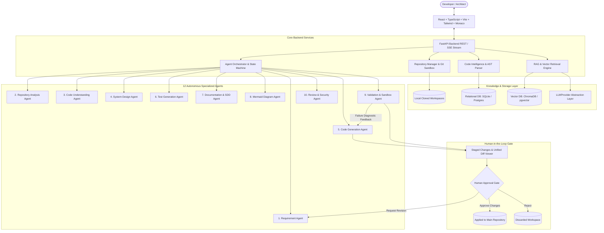

# Engineering Intelligence Hub: Architecture Specification

## 1. System Overview

The **Engineering Intelligence Hub (EIH)** is an autonomous agentic software engineering platform for repository understanding, code intelligence, grounded RAG Q&A, multi-agent code generation, testing, documentation, and human-in-the-loop change management.

---

## 2. Key Architectural Layers

### A. Frontend Layer
- **Framework**: React 18 + TypeScript + Vite
- **Styling**: Tailwind CSS with custom engineering-console dark theme
- **Diagrams**: Mermaid.js dynamic rendering
- **Code & Diffs**: Unified diff viewer with syntax highlighting and line numbers
- **Communication**: REST API client with Axios and reactive polling state

### B. API & Application Layer
- **Framework**: FastAPI (Async ASGI) with Pydantic v2 validation
- **Modular Routers**:
  - `/api/v1/repositories`: Ingestion, file tree hierarchy, and content retrieval.
  - `/api/v1/intelligence`: Symbol extraction, dependencies, and architecture topology.
  - `/api/v1/chat`: Grounded RAG questions with verifiable citations.
  - `/api/v1/tasks`: Autonomous multi-agent engineering workflows.
  - `/api/v1/tasks/{id}/approve|reject|revise`: Human-in-the-loop control.
  - `/api/v1/research`: Benchmarking metrics and comparison matrices.

### C. Repository & Sandbox Isolation
- Cloned repositories are isolated in `cloned_repos/<repo_id>`.
- Engineering tasks execute in an isolated staging workspace `workspaces/<task_id>`.
- Code changes are diffed using standard Python `difflib`.
- **Zero In-Place Overwrites**: Source repository files are never modified until explicit human approval.

### D. Multi-Agent State Machine
The agent state is modeled in `AgentState`, tracking:
- `task_id`, `repository_id`, `user_requirement`, `complexity`
- `task_plan`: list of ordered discrete tasks
- `proposed_changes`: list of modified/added files with diffs and explanations
- `generated_tests`: pytest test suites
- `diagrams`: Mermaid sequence and component architecture diagrams
- `validation_results`: AST syntax, imports, and subprocess test outcomes
- `review_results`: Security and code quality audit scores
- `retry_count`: Self-correction loop iterator (capped by `MAX_AGENT_RETRIES=3`).
